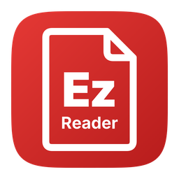
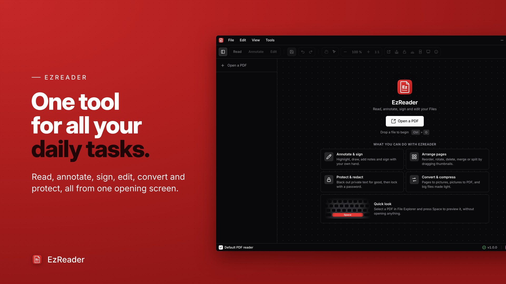

<div align="center">



# EzReader

**A fast, lightweight PDF reader and editor for Windows, macOS and Linux.**

Read, annotate, sign, edit, reorganize, compress and protect your PDFs.<br>
Everything runs on your computer: no account, no subscription, no AI, no telemetry.

[](https://github.com/alxbdn/EzReader/releases/latest)
[](https://github.com/alxbdn/EzReader/releases)
[](#installation)
[](https://apps.microsoft.com/detail/9P9PVN4DRVS8)
[](LICENSE)

[](https://github.com/alxbdn/EzReader/actions/workflows/ci.yml)
[](https://github.com/alxbdn/EzReader/actions/workflows/security.yml)
[](https://github.com/alxbdn/EzReader/actions/workflows/perf.yml)
[](https://scorecard.dev/viewer/?uri=github.com/alxbdn/EzReader)

[Install](#installation) · [Features](#features) · [Security](#security-and-privacy) · [Build](#build-from-source) · [Contributing](CONTRIBUTING.md)

<br>



</div>

---

## Installation

Pick your system and paste the command.

### Windows

Windows 10 (2004+) and 11, 64-bit. From the Microsoft Store, in PowerShell or the Terminal:

```powershell
winget install --id 9P9PVN4DRVS8 --source msstore --accept-package-agreements
```

Without the Store, this downloads the latest installer from GitHub and runs it:

```powershell
$u = (irm https://api.github.com/repos/alxbdn/EzReader/releases/latest).assets.browser_download_url -like '*-win-x64-setup.exe'
iwr "$u" -OutFile "$env:TEMP\ezreader-setup.exe"; & "$env:TEMP\ezreader-setup.exe"
```

### macOS

macOS 11+, Intel and Apple Silicon, with [Homebrew](https://brew.sh):

```bash
brew install --cask alxbdn/ezreader/ezreader
```

### Linux

x64. On Debian, Ubuntu and derivatives, this downloads the latest package and installs it:

```bash
curl -sL https://api.github.com/repos/alxbdn/EzReader/releases/latest | grep -o 'https://[^"]*_amd64\.deb' | xargs curl -LO
sudo apt install ./ezreader_*_amd64.deb
```

On any other distribution, the portable app needs nothing installed:

```bash
curl -sL https://api.github.com/repos/alxbdn/EzReader/releases/latest | grep -o 'https://[^"]*-linux-x64"' | tr -d '"' | xargs curl -L -o ezreader
chmod +x ezreader && ./ezreader
```

The welcome screen shows whether your version is up to date: a green check, or a red cross and an *Update* button that installs the new version (the Store version opens the Microsoft Store). You can also update by hand: `winget upgrade --id 9P9PVN4DRVS8`, `brew upgrade --cask ezreader`, or run the same GitHub commands again.

### Download the files

Prefer to download? **[Get the latest release](https://github.com/alxbdn/EzReader/releases/latest)**, about 3 MB, and pick the file for your system.

| System | File | What it is |
|--------|------|------------|
| **Windows** | `ezreader-<version>-win-x64-setup.exe` | Installer |
| | `ezreader-portable-<version>-win-x64.exe` | Portable app: a single file you can run from anywhere |
| | `ezreader-<version>-win-x64.msix` | Package, also on the [Microsoft Store](https://apps.microsoft.com/detail/9P9PVN4DRVS8) |
| **macOS** | `ezreader-<version>-macos-universal.dmg` | Disk image |
| **Linux** | `ezreader_<version>_amd64.deb` | Package for Debian, Ubuntu and derivatives |
| | `ezreader-portable-<version>-linux-x64` | Portable app: make it executable (`chmod +x`) and run it |

The macOS app is not notarized by Apple: installed with Homebrew it opens straight away; from the disk image, right-click EzReader in Applications and choose **Open** the first time.

Each release also carries its **security report**, its **performance report** and the **software bills of materials** (CycloneDX) of its dependencies.

---

## Features

EzReader opens on a home screen with a shortcut to each task: annotate, sign, redact, manage pages, convert, compress, protect, straighten scans and merge. Once a file is open, it has three modes, picked from the toolbar: **Read**, **Annotate** and **Edit**. The pages side panel and the File, Edit, View and Pages menus are available in all of them.

### Read

- Sharp rendering at any zoom, powered by PDF.js
- Zoom in and out (Ctrl+wheel zooms around the mouse), fit to width or height, actual size (1:1, calibrated to your screen), or type any percentage
- **Page brightness**: dim glaring white pages from the toolbar, 1 % at a time down to 40 %. Only the screen changes, never the file
- Full screen (F11)
- One, two or three pages per row, with vertical or horizontal scrolling
- Hand tool to drag the page around, or text selection to copy text
- Search the whole document (Ctrl+F) and jump between matches
- Fill in interactive forms: text fields, checkboxes and radio buttons
- Document info: page size, PDF version, author, producer, dates and keywords
- Rename the open file by clicking its name in the toolbar
- Open files by dropping them onto the window

### Annotate

- **Text** with font, size, color and background
- **Pencil**, freeform or straight lines, with color, thickness and opacity
- **Shapes**: rectangle, ellipse and arrow, with outline and fill colors
- **Highlighter** on selected text (select it again to remove the highlight)
- **Sticky notes**
- **Signatures**: draw one or import a picture, keep up to three saved, and place them anywhere. Drawn signatures stay vector curves, sharp at any size
- Annotations can be dragged to another page
- Each change is validated (Enter) or discarded (Esc), and everything can be undone and redone (Ctrl+Z, Ctrl+Y)
- Annotations stay editable when you reopen the file

### Edit

- **Edit text**: click existing text in the PDF to replace it
- **Images**: browse for a picture or drop one on a page to place it
- **Redact** selected text or an area. Redactions are permanent once saved: the content under the black boxes is removed, not just hidden
- **Stamps**: check marks and crosses
- **Crop** pages, with handles and automatic content margins
- **Straighten** scanned pages by placing each corner with a magnifying loupe. A preview shows the straightened page as you go
- Flip pages vertically or horizontally

### Manage pages

The side panel shows a thumbnail of every page.

- Select pages, then rotate, delete or export them. Page edits can be undone and redone too
- Drag thumbnails to reorder pages (Ctrl+← and Ctrl+→ with the keyboard)
- Insert a blank page, insert another PDF, or add a PDF at the end to merge files
- Drop a picture in the panel to add it as a new page
- Drag pages out of the window to open them in a new window
- Extract the selected pages to a new PDF, or split the document into several files (every page, every N pages, or custom ranges)

Extracted, split and rearranged files contain nothing from the pages you left out: their text, images and annotations are removed from the output, not just hidden.

### Export, compress and protect

- **Export** pages as PNG or JPEG images (96, 150 or 300 dpi), or as a flattened PDF copy, with or without annotations
- **Convert** the text of a PDF to Word (.docx), Excel (.xlsx, one sheet per page), RTF, a web page (HTML), plain text or XML. Paragraphs, titles and tables are kept; pictures and the exact layout are not
- **Select text in scans and pictures**: pages without text are read in the background by the OCR engine built into the system, and their words become selectable and copyable like any text. Only the pages on screen are read, once each, on your computer.
- **Recognize text (OCR)** in scanned pages and pictures with the OCR engine built into Windows: the page on the left with the words found outlined, the text on the right, ready to copy. It reads the languages installed in Windows and adds nothing to the app's size. On macOS it uses the engine built into macOS (Vision) the same way. On Linux, the PaddleOCR models (RapidOCR) are built into the app: languages written in the Latin alphabet, nothing to install
- **Images to PDF**: turn a set of pictures into a PDF, one picture per page
- **Compress** with a Lossless, Balanced or Maximum preset, or give a target size and let EzReader find the best quality under it. The estimated result is shown before you save
- **Password**: protect a PDF with a password (with a strength meter and tips), open protected PDFs, or remove the protection
- **Print** with a choice of printer, pages, copies, orientation and scale

### Settings and system integration

- Light, dark or system theme
- Default zoom when a file opens
- Page brightness, remembered between sessions
- 20 interface languages, switched instantly: English, Français, 中文, हिन्दी, Español, العربية, বাংলা, Русский, Português, اردو, Bahasa Indonesia, Deutsch, 日本語, Kiswahili, मराठी, తెలుగు, Türkçe, தமிழ், Tiếng Việt, 한국어
- On Windows, set EzReader as the default PDF viewer from Settings, no administrator rights needed
- Print from the command line: `ezreader-portable.exe --print file.pdf`

---

## Security and privacy

EzReader never sends your documents or your usage anywhere. Full details in the [privacy policy](PRIVACY.md).

- No account, no AI, no telemetry
- One request on its own: the latest version number, from GitHub, at startup
- PDFs open in a locked-down viewer: document scripts never run, and the page cannot reach the network
- The app only reads and writes the files you open or pick in a dialog
- Its temporary copies, including decrypted ones, are removed when you close it, or on the next start after a crash

Every push, every pull request and every week, GitHub Actions checks the code:

| Check | Tool |
|-------|------|
| Known vulnerabilities in dependencies (SCA) | `npm audit`, `cargo deny` (RustSec advisories, licenses, sources) |
| Static analysis (SAST) | CodeQL `security-extended` on TypeScript, Rust and the workflows |
| Dynamic testing | Fuzzing of the PDF and picture parsers with cargo-fuzz (libFuzzer) |
| Load test | A 1,500-page PDF opened, scrolled and zoomed while memory and CPU are measured |
| Supply chain | Dependabot updates, third-party actions pinned to a commit, [OpenSSF Scorecard](https://scorecard.dev/viewer/?uri=github.com/alxbdn/EzReader) |

The results of each release are attached to it as PDF reports. To report a vulnerability privately, see [SECURITY.md](SECURITY.md). How EzReader stands against the EU Cyber Resilience Act: [docs/cra](docs/cra/README.md).

---

## Build from source

EzReader is built with Rust, TypeScript and [Tauri 2](https://tauri.app). You need Rust (stable), Node.js 18 or later, and the [Tauri prerequisites](https://tauri.app/start/prerequisites/) for your system.

```bash
npm install
npm run tauri dev      # run in development
npm run tauri build    # build the release app
```

The frontend lives in `src/` and the Rust backend in `src-tauri/`. Before opening a pull request, run the checks that CI runs:

```bash
npm run build
npm test
cd src-tauri && cargo clippy --all-targets -- -D warnings && cargo test
```

Bug reports and ideas are welcome in the [issues](https://github.com/alxbdn/EzReader/issues). See [CONTRIBUTING.md](CONTRIBUTING.md) to send a change.

---

## Credits and license

EzReader started as a fork of [PDF Rider](https://github.com/pleymor/pdf-rider) by pleymor, used under the MIT license. Thanks to its author for the foundation this app is built on.

PDF rendering uses [PDF.js](https://mozilla.github.io/pdf.js/) by Mozilla.

EzReader is released under the [MIT license](LICENSE).
