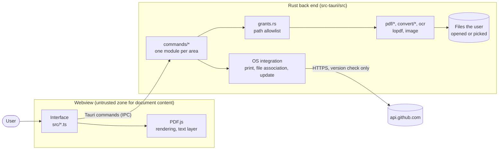

# Architecture

EzReader is a [Tauri 2](https://tauri.app) desktop app: a TypeScript interface running in the system webview, and a Rust back end that does all file and PDF work. The two halves talk only through Tauri commands.

## Front end (`src/`)

- Plain TypeScript (strict mode), no framework, bundled by Vite.
- `pdf-viewer.ts` drives [PDF.js](https://mozilla.github.io/pdf.js/) to render pages, the text layer and form fields. PDF.js runs with document scripts off (`pdf-options.ts`).
- Sessions hold the state of an open document: `document-session.ts` (file, unsaved changes), `annotation-session.ts` (annotations, undo and redo, redaction), `page-history.ts` (page edits).
- Tools and panels are one module each: `toolbar.ts`, `studio-panel.ts`, `page-sidebar.ts`, `doc-tabs.ts`, the `*-modal.ts` dialogs.
- `backend.ts` defines the interface to the back end; `tauri-backend.ts` implements it with Tauri commands, so the interface can be tested without Tauri.
- `i18n.ts` holds every interface string in 20 languages.

## Back end (`src-tauri/src/`)

- `commands/` exposes the Tauri commands, grouped by area: `pdf.rs` (save annotations, rearrange, extract, split, straighten, redact, adjust), `security.rs` (password protection), `compress.rs`, `convert.rs` (Word, Excel, RTF, HTML, text, XML), `ocr.rs`, `files.rs`, `dialog.rs`, `shell.rs` (printing, links, default PDF app), `update.rs`, `window.rs`.
- `grants.rs` is the security gate: every command that touches a file checks the path against the files and folders the user opened or picked.
- `pdf/` holds the PDF engines on top of [lopdf](https://github.com/J-F-Liu/lopdf): writing annotations, flattening, forms, redaction, compression, straightening.
- `convert/` exports text and tables to office formats; `ocr.rs` and `rapid_ocr.rs` recognize text in scans (Windows and macOS system OCR, built-in models on Linux).
- `tempfiles.rs` manages temporary working copies and removes them at exit or after a crash.
- `error.rs` returns coded errors (`ErrorCode`) that the interface translates.

## Windows Explorer add-in (`src-tauri/shell-ext/`)

A separate DLL (`ezreader_shell.dll`) that Explorer loads: a thumbnail provider (page 1 of a PDF as its icon) and a preview handler (the pages in the preview pane, also used by PowerToys Peek). It draws pages with the PDF engine built into Windows (`Windows.Data.Pdf`), so nothing is bundled. `npm run build:shell-ext` builds it as part of the Windows build (`tauri.windows.conf.json`). The setup .exe registers it (`src-tauri/windows/installer-hooks.nsh`) and the Store package declares it (`AppxManifest.xml`); the portable .exe has no add-in.

The same crate builds `ezreader-quicklook.exe`, the quick-look helper. Once turned on in Settings, it starts with Windows (a `Run` value for the setup version, a startup task for the Store version). A low-level keyboard hook on its own thread watches for Space only while File Explorer's file list has focus; the main thread then reads Explorer's selection (`IShellWindows`) and, for a PDF, opens a window that reuses the preview pane's page column. Any other selection gets its Space back. `ezreader-quicklook.exe --preview <file>` opens the window for one file, for testing.

## Data flow

1. The user opens a file (dialog, drag and drop, command line). The back end records it in the grants and returns its bytes; PDF.js renders it.
2. Edits (annotations, page changes, form values) live in the interface sessions until the user saves.
3. On save, the interface sends the edits to a command; the Rust engine writes a new PDF with lopdf and replaces the file.

## Build and release

- `npm run tauri build` produces the app for the current platform; GitHub Actions builds Windows (installer, portable, MSIX) and Linux (`.deb`, portable) for each release; the Homebrew tap (alxbdn/homebrew-ezreader) builds the macOS universal `.dmg` from the release tag and publishes it there.
- Releases come only from the *Bump & Release* and *Release* workflows. See [SECURITY.md](../.github/SECURITY.md#how-ezreader-is-checked) and [GOVERNANCE.md](../.github/GOVERNANCE.md#releases).

## Tests

| Layer | Where | Run with |
|-------|-------|----------|
| Interface unit tests | `src/__tests__/` | `npm test` (Vitest) |
| Interface flows in a browser (coverage) | `tests/ui/` | `npm run test:ui` (Playwright, Tauri stubbed) |
| Rust unit tests | `#[cfg(test)]` modules next to the code | `cargo test` |
| Explorer add-in | `src-tauri/shell-ext/` | `cargo test --manifest-path src-tauri/shell-ext/Cargo.toml` (Windows) |
| Hostile input and PDF corpus | `src-tauri/src/hostile_input_tests.rs`, `corpus_tests.rs` | `cargo test` |
| End-to-end on the real app | `tests/e2e/` | `npm run test:e2e` |
| Visual regression | `tests/visual/` | `npm run test:visual` |
| Load test | `tests/perf/` | `npm run test:perf` |
| Fuzzing | `src-tauri/fuzz/` | `cargo fuzz run <target>` |
