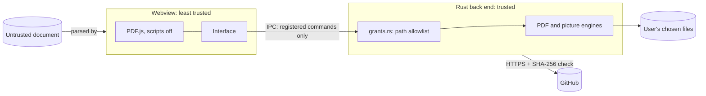

# Security assurance case

This document argues why EzReader meets its security requirements. It covers the threat model, the trust boundaries, how the secure design principles are applied, and how common implementation weaknesses are countered. The evidence points to code, tests and CI. The [OWASP Desktop App Top 10 self-assessment](owasp-desktop-top10.md) goes risk by risk in more detail.

*Last reviewed: 16 November 2026, for EzReader 1.1.*

## Security requirements

1. **R1. A malicious document cannot run code**, either in the interface or on the computer.
2. **R2. A document or the interface cannot read or write files** other than those the user opened or picked.
3. **R3. Documents and usage never leave the computer.** The only network request is the update check.
4. **R4. Password protection resists offline attack** as well as the PDF standard allows.
5. **R5. Redaction really removes** the content under the black boxes.
6. **R6. Users can tell that a download or an update is genuine.**

## Threat model

| Attacker | Wants to | Entry point |
|----------|----------|-------------|
| Author of a malicious PDF or picture | Run code, read other files, exfiltrate data, crash the app | A document the user opens |
| Network attacker | Serve a fake update | The update check and download |
| Supply-chain attacker | Ship malicious code in a dependency or a release | npm and Cargo dependencies, GitHub Actions, release assets |
| Someone with access to the user's profile | Read saved signatures or leftover temp copies | Local files |

Out of scope: an attacker who already runs code as the user or as administrator. EzReader has no server, no account and no listening port, so there is no remote attack surface other than the update check.

## Trust boundaries

1. **Document → webview.** Every byte of a document is untrusted. PDF.js parses it with JavaScript evaluation off; the Content Security Policy forbids remote scripts and connections.
2. **Webview → Rust.** The webview is treated as possibly compromised. It can only call the registered commands; the Tauri capabilities expose no file system, shell or HTTP plugin; every path is checked against the grants.
3. **Rust → network.** One HTTPS request to GitHub, HTTPS only even after redirects, and the downloaded update must match its published SHA-256 digest.
4. **Repository → release.** Releases are built only by GitHub Actions, after the security scans pass, with signed provenance.

## Secure design principles

| Principle | How EzReader applies it | Evidence |
|-----------|-------------------------|----------|
| Economy of mechanism | No server, account, plugin system or own cryptography. Small set of commands. | [architecture](../architecture.md) |
| Fail-safe defaults | Document scripts off; a path not in the grants is refused; an update that fails its digest is deleted. | `src/pdf-options.ts`, `src-tauri/src/grants.rs`, `src-tauri/src/commands/update.rs` |
| Complete mediation | Every file command checks every path through `grants::check`. | `src-tauri/src/grants.rs` and its tests |
| Open design | All code, workflows and this analysis are public. | this repository |
| Separation of privilege | The interface cannot reach files; only the Rust side can, after the grant check. Linux updates ask for the admin password through `pkexec`. | `src-tauri/capabilities/default.json` |
| Least privilege | The app never runs elevated; CI tokens are read-only except for the jobs that publish. | `.github/workflows/` |
| Least common mechanism | Each document's temp copies are separate and removed at exit. | `src-tauri/src/tempfiles.rs` |
| Psychological acceptability | Security needs no setting: the safe behavior is the only behavior. | — |
| Input validation with allowlists | Paths (grants), link schemes (`http`/`https` only), picture formats, PDF structure checked by lopdf. | `src-tauri/src/commands/shell.rs`, `src-tauri/src/hostile_input_tests.rs` |

## Countering common weaknesses

| Weakness (CWE) | Counter | Evidence |
|----------------|---------|----------|
| Memory corruption (CWE-119, 787, 416) | Back end in Rust; `unsafe` only around OS calls. Fuzzing of the PDF and picture parsers with AddressSanitizer. | `src-tauri/fuzz/`, Security workflow |
| Cross-site scripting (CWE-79) | Document text and file names go through `textContent`; CSP `script-src 'self'`. | `src-tauri/tauri.conf.json` |
| Path traversal (CWE-22) | Grant allowlist on absolute, normalized paths. | `src-tauri/src/grants.rs` |
| OS command injection (CWE-78) | External programs started with separate arguments, never a shell string. | `src-tauri/src/commands/shell.rs` |
| Open redirect, dangerous URL schemes | Only `http`/`https` links with a host are opened. | `shell.rs` tests |
| Uncontrolled resource use (CWE-400) | Fuzzing with memory and time limits (2 GB, 10 s per input); load test of a 1,500-page PDF on every pull request. | `tests/perf/`, fuzz settings |
| Broken or weak crypto (CWE-327) | AES-256 (PDF revision 6) through lopdf; SHA-256 for updates; OS random generator. | `src-tauri/src/commands/security.rs` |
| Hard-coded credentials (CWE-798) | None; CodeQL and GitHub secret scanning check it. | Security tab |
| Insufficient verification of data authenticity (CWE-345) | Update digest check; signed SLSA provenance on every release. | [SECURITY.md](../../.github/SECURITY.md) |
| Vulnerable dependencies (CWE-1395) | `npm audit`, `cargo deny`, Dependabot; a release is blocked if they fail. | Security workflow |

## Residual risks

- Saved signatures are stored unencrypted in the webview's storage (planned: system keychain, see [ROADMAP.md](../../.github/ROADMAP.md)).
- The Windows downloads from GitHub are not yet Authenticode-signed, and the macOS app is not notarized. Provenance lets users check them meanwhile.

## Keeping this case current

This file is reviewed with every major release and whenever a new kind of input, a new network access or a new command is added.
